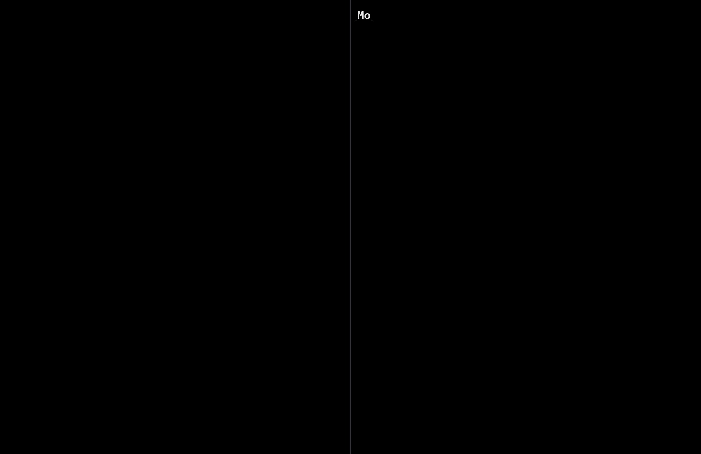
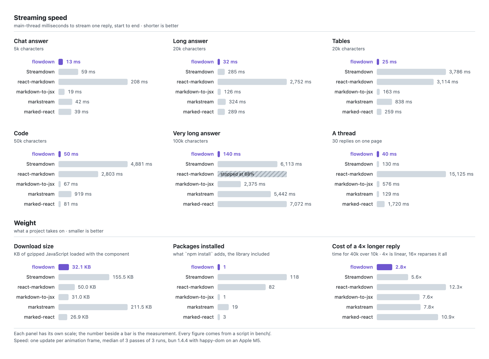
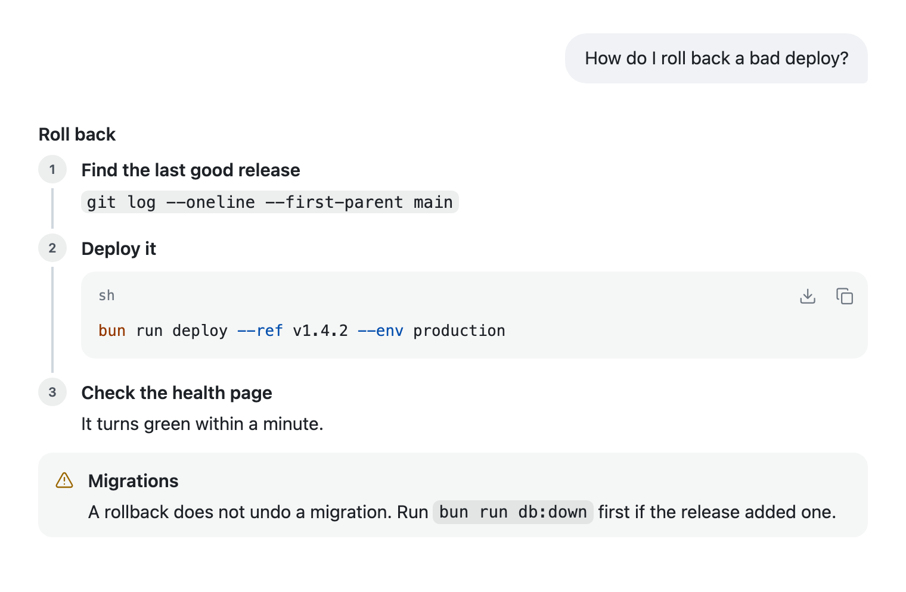
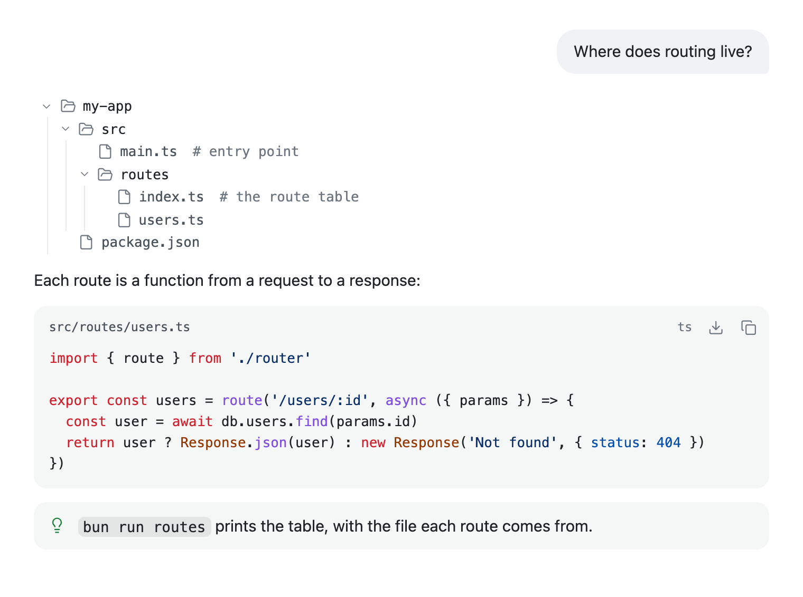
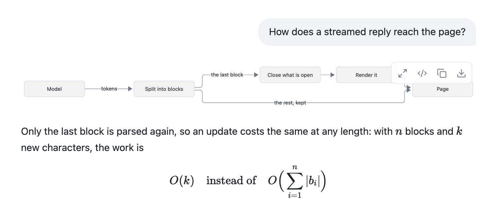
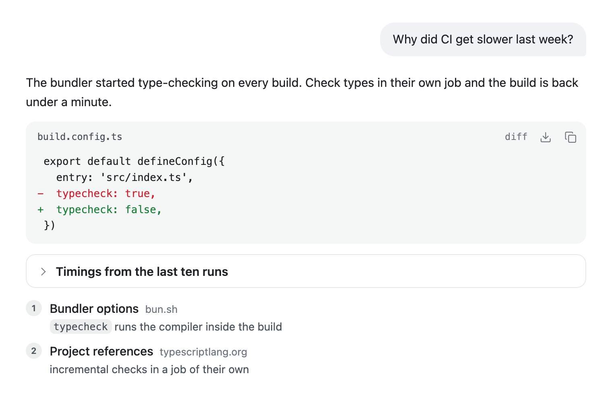
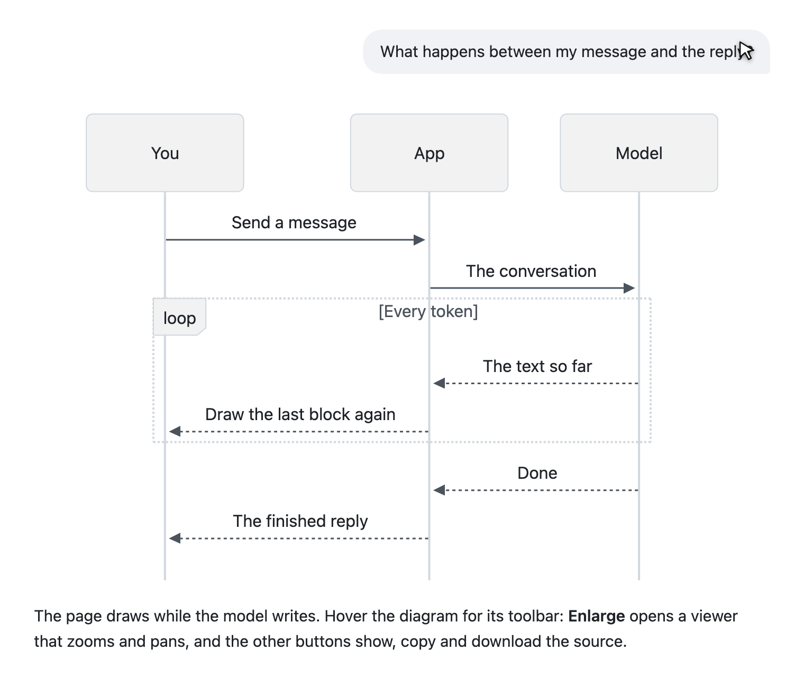
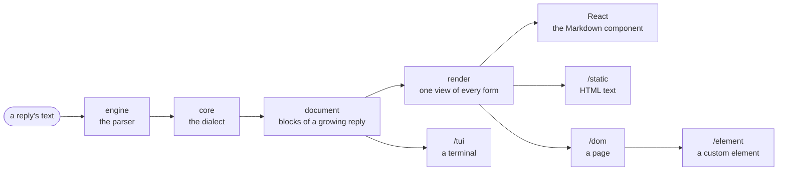
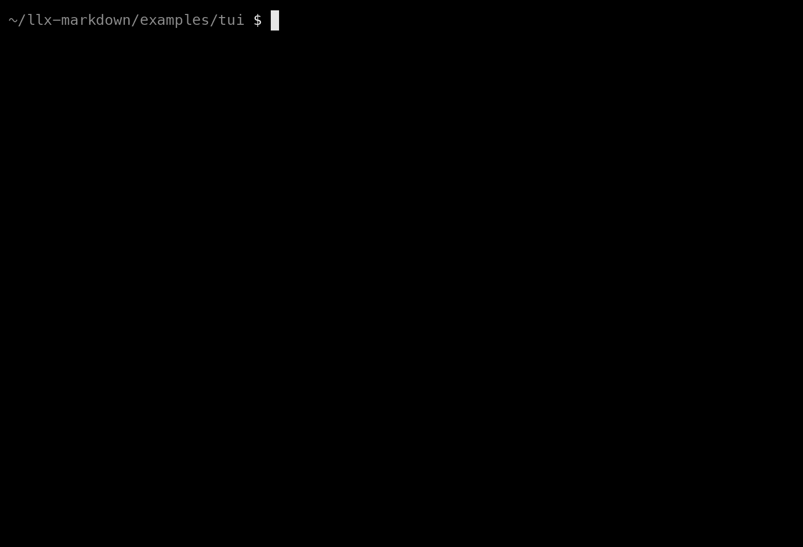

<p align="center">
  
</p>

<h1 align="center">llx-markdown</h1>

<p align="center">
  <strong>Ultrafast, lightweight streaming Markdown for React and AI replies</strong><br>
  Its own parser · 0 dependencies · 31.7 KB gzipped · 17× faster on a long stream
</p>

<p align="center">
  <a href="https://www.npmjs.com/package/llx-markdown"></a>
  <a href="https://github.com/rsaryev/llx-markdown/actions/workflows/ci.yml"></a>
  <a href="packages/llx-markdown/LICENSE"></a>
  <a href="https://www.anthropic.com/claude/fable"></a>
</p>

<p align="center">
  <a href="docs/getting-started.md">Get started</a> ·
  <a href="docs/syntax.md">Syntax</a> ·
  <a href="docs/api.md">API</a> ·
  <a href="#beyond-react">Beyond React</a> ·
  <a href="#in-a-terminal">Terminal</a> ·
  <a href="docs/comparison.md">Comparison</a> ·
  <a href="bench/README.md">Benchmarks</a>
</p>

<p align="center">
  
</p>

<p align="center">
  <sub>One reply, streamed twice: by <code>&lt;Markdown&gt;</code> on a page and by <code>llx-markdown/tui</code> <a href="#in-a-terminal">in a terminal</a>.</sub>
</p>

GitHub Markdown, plus the forms a model can write and a reader can scan: steps, tabs, headline
figures, pros and cons, callouts, folded sections, sources, file trees, titled code, diagrams and
math. It is drawn as the text arrives, without flicker or raw syntax showing.

```sh
npm install llx-markdown
```

```tsx
import { Markdown } from 'llx-markdown'
import 'llx-markdown/styles.css'

export function Reply({ text, done }: { text: string; done: boolean }) {
  return <Markdown streaming={!done}>{text}</Markdown>
}
```

> [!TIP]
> A model writes the forms once its system prompt has the dialect: `answerFormatPrompt()` from
> `llx-markdown/prompt` is that text. [Prompting](docs/prompting.md) has the details.

The same package draws a reply [outside React](#beyond-react) too. The rest is in
[the package's README](packages/llx-markdown/README.md) and
[the documentation](docs/getting-started.md).

## Why

- **Fast.** A 100k-character reply streams in 0.13 s.[^bench] The next fastest renderer takes 2.3 s
  and Streamdown 6.3 s. It wins all 16 streaming runs.
- **Linear.** A reply four times longer costs about three times more, not sixteen. No update takes
  more than 5 ms, so a stream never drops a frame.
- **Repairs a reply mid-stream.** Unfinished `**bold`, half-typed links and open code fences never
  show their raw syntax.
- **Complete.** Its parser passes every example of CommonMark and of GitHub's extensions
  ([conformance](docs/conformance.md)). Alerts, footnotes and raw HTML need no setup.
- **Light.** One package with no dependencies: 31.7 KB gzipped,[^size] against 156 KB for
  Streamdown. It comes styled, without Tailwind.
- **Safe.** Raw HTML from a reply is parsed and sanitized, and links are held to safe protocols
  ([security](docs/security.md)).

<p align="center">
  
</p>

> [!NOTE]
> Where it is not the best choice: marked-react is a little smaller (27 KB), though it does not
> repair a streaming reply and draws less Markdown, and markdown-to-jsx is about the same size
> (31 KB). react-markdown has the remark and rehype plugin ecosystem; here your own syntax is an
> [extension](docs/remark.md).

[The full comparison](docs/comparison.md) has every check, figure and source, and says which
renderer suits which project.

## What a reply can hold

Everything GitHub draws, and the forms below. Each is plain Markdown a model already writes, so a
reply pasted into an issue still reads: a form falls back to a quote, a list or headings.

| Form            | A model writes                           | It is drawn as                               |
| --------------- | ---------------------------------------- | -------------------------------------------- |
| Callout         | `> [!WARNING] Downtime`                  | a titled note in its colour                  |
| Steps           | `> [!STEPS]` over a numbered list        | a timeline                                   |
| Tabs            | `> [!TABS]` over `####` headings         | tabs, one per heading                         |
| Stats           | `> [!STATS]` over `- **3×** faster`      | headline figures                             |
| Pros and cons   | `> [!PROS]`, then `> [!CONS]`            | two columns side by side                     |
| Folded section  | `> [!DETAILS] Timings`                   | a title that opens                           |
| Sources         | `> [!SOURCES]` over links                | a numbered list, each link with its site     |
| File tree       | a `tree` fence                           | a tree that folds                            |
| Titled code     | a fence opened with `ts src/main.ts`     | the file name in its bar, copy and download  |
| Diagram         | a `mermaid` fence                        | the diagram, in the page's colours           |
| Math            | `$r = n / t$`, `$$…$$`                   | KaTeX                                        |

[Syntax](docs/syntax.md) has every form with what it draws. Each picture below is one reply drawn by
`<Markdown>`, from the Markdown in [demo/scenes](demo/scenes).

**Steps, a code block and a callout**

<p align="center">
  <picture>
    <source media="(prefers-color-scheme: dark)" srcset="docs/assets/readme/steps-dark.png">
    
  </picture>
</p>

<details>
<summary>The Markdown behind this picture</summary>
<br>

````markdown
> [!STEPS] Roll back
1. **Find the last good release**
   `git log --oneline --first-parent main`
2. **Deploy it**
   ```sh
   bun run deploy --ref v1.4.2 --env production
   ```
3. **Check the health page**
   It turns green within a minute.

> [!WARNING] Migrations
> A rollback does not undo a migration. Run `bun run db:down` first if the release added one.
````

</details>

**A file tree and highlighted code**

<p align="center">
  <picture>
    <source media="(prefers-color-scheme: dark)" srcset="docs/assets/readme/code-dark.png">
    
  </picture>
</p>

**Diagrams and math**, drawn with Mermaid and KaTeX in the page's colours

<p align="center">
  <picture>
    <source media="(prefers-color-scheme: dark)" srcset="docs/assets/readme/diagram-dark.png">
    
  </picture>
</p>

<details>
<summary><b>More:</b> a diff with sources, and the diagram viewer</summary>
<br>

**A diff with its file name, a folded section and sources**

<p align="center">
  <picture>
    <source media="(prefers-color-scheme: dark)" srcset="docs/assets/readme/sources-dark.png">
    
  </picture>
</p>

**The diagram viewer** zooms and pans with the pointer, the wheel or a pinch. From the keyboard:
<kbd>+</kbd> and <kbd>-</kbd> zoom, the arrow keys pan, <kbd>0</kbd> fits the window and
<kbd>Esc</kbd> closes.

<p align="center">
  <picture>
    <source media="(prefers-color-scheme: dark)" srcset="docs/assets/readme/viewer-dark.png">
    
  </picture>
</p>

</details>

## Beyond React

`<Markdown>` is one of five targets. All read the same text with the same parser and the same
dialect, and an import path picks one:



| Import                 | Draws                                               | Runs                    |
| ---------------------- | --------------------------------------------------- | ----------------------- |
| `llx-markdown`         | React elements                                      | wherever React does     |
| `llx-markdown/static`  | HTML text: a server, an email, a static site        | anywhere, no page       |
| `llx-markdown/dom`     | a page with no framework, kept up to date in place  | a browser               |
| `llx-markdown/element` | `<llx-markdown>`, for Vue, Svelte, Solid or Angular | a browser               |
| `llx-markdown/tui`     | the rows of a terminal                              | anywhere, no page       |

None but the first imports React, and none imports any package. The other four load 28 to 31 KB
gzipped each.[^size]

<details>
<summary><b>HTML text</b>, on a server</summary>
<br>

```ts
import { renderToHtml } from 'llx-markdown/static'

const html = renderToHtml(reply, { headingIds: true })
```

</details>

<details>
<summary><b>A page with no framework</b>, as the reply streams</summary>
<br>

```ts
import { mount } from 'llx-markdown/dom'
import 'llx-markdown/styles.css'

const reply = mount(document.querySelector('#reply')!)
for await (const text of stream) reply.update(text, { streaming: true })
reply.update(text)
```

</details>

<details>
<summary><b>A custom element</b>, in any framework</summary>
<br>

```ts
import { defineMarkdownElement } from 'llx-markdown/element'
import 'llx-markdown/styles.css'

defineMarkdownElement()
```

```html
<llx-markdown streaming></llx-markdown>
```

</details>

[Other targets](docs/targets.md) has the options of each, and how to write a target of your own.

### In a terminal

`llx-markdown/tui` draws the same reply as rows of styled text: steps as a chain, figures as tiles,
a file tree with its branches and code in the highlighter's colours. A formula is written in
Unicode: $`\mu = \frac{1}{k} \sum_{i=1}^{k} r_i`$ becomes `μ = 1/k ∑ᵢ₌₁ᵏ rᵢ`.

<p align="center">
  
</p>

```ts
import { highlight } from 'llx-markdown/highlight'
import { renderToAnsi } from 'llx-markdown/tui'

process.stdout.write(renderToAnsi(reply, { width: process.stdout.columns, highlight }) + '\n')
```

The recording is [`examples/tui`](examples/tui) as it runs, with every form of the dialect:
`bun start` in that folder plays it in your terminal.

## Development

| Path                    | What it holds                                        |
| ----------------------- | ---------------------------------------------------- |
| `packages/llx-markdown` | the library                                          |
| `docs/`                 | the documentation, as Markdown; `nav.json` orders it |
| `demo/`                 | the scenes above and the script that captures them   |
| `examples/tui`          | a reply streamed into a terminal: `bun start`        |
| `bench/`                | rendering benchmarks against other renderers         |

```sh
bun install
bun run test        # the library's tests; CI skips the heavy sweeps (LLX_SKIP_HEAVY=1)
bun run check       # build output: exports, types, entry isolation
bun run shots       # the pictures above, from demo/scenes
bun run size        # bundle size, against its budgets
bun run bench       # the benchmarks
```

CI checks every push to `main` and every pull request. A tag `v<version>` publishes that version to
npm ([release workflow](.github/workflows/release.yml)). How to work on it, and what a change has
to keep: [CONTRIBUTING.md](CONTRIBUTING.md).

[^bench]:
    Main-thread time to stream the reply into a page, measured the same way for every renderer.
    The method and every run are in [bench](bench/README.md); `bun run bench` reruns them.

[^size]:
    What the entry loads at once, minified and gzipped: `bun run size` for the entries of the
    package, [bench/results/size.md](bench/results/size.md) for the comparison.
