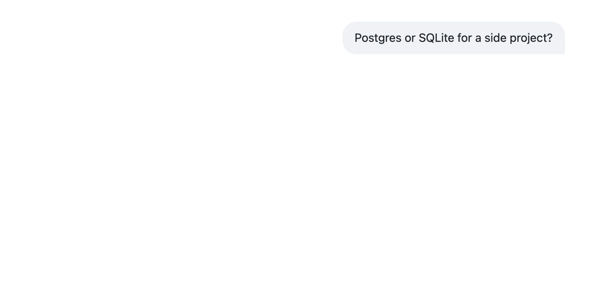
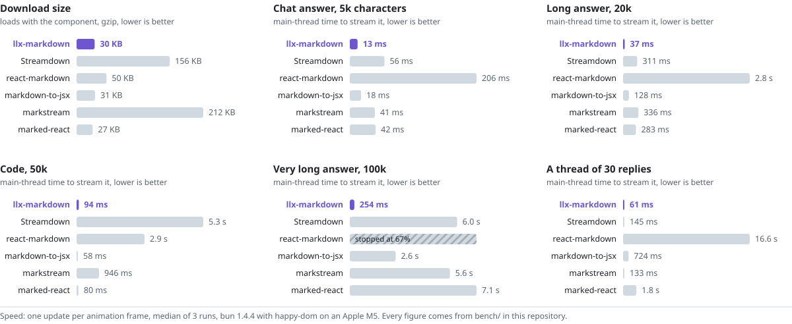

# llx-markdown

Markdown for AI replies and documentation in React: GitHub Markdown plus steps, tabs, stats, pros
and cons, callouts, file trees, diagrams and math, rendered while it streams, without flicker or
raw syntax showing.

<picture>
  <source media="(prefers-color-scheme: dark)" srcset="docs/assets/readme/stream-dark.png" />
  
</picture>

```tsx
import { Markdown } from 'llx-markdown'
import 'llx-markdown/styles.css'

export function Reply({ text, done }: { text: string; done: boolean }) {
  return <Markdown streaming={!done}>{text}</Markdown>
}
```

Install, usage and the rest: [packages/llx-markdown](packages/llx-markdown/README.md) and
[the documentation](docs/getting-started.md).

## Compared with similar libraries

<picture>
  <source media="(prefers-color-scheme: dark)" srcset="bench/results/charts/compare-dark.svg">
  
</picture>

**Where llx-markdown is strong**

- **It stays fast as a reply grows.** A 100k-character reply streams in 0.9 s. The next fastest
  takes 2.6 s, and Streamdown takes 7.3 s.
- **It repairs a reply mid-stream.** Unfinished `**bold`, half-typed links and open code fences
  never show their raw syntax.
- **It draws more Markdown.** GitHub alerts, footnotes and raw HTML need no setup. Of six
  renderers, it is the only one that passes every check.
- **It is half the size of Streamdown**, 82 KB against 156 KB gzipped, and comes styled without
  Tailwind.

**Where it is not**

- **markdown-to-jsx is smaller and faster on short text.** It is 31 KB and one package, and several
  times faster on short replies, code and tables.
- **It installs the most packages of the six**, 125.

**[Read the full comparison →](docs/comparison.md)** It has every check, figure and source, and
says which renderer suits which project. Every number comes from a script in [bench](bench) that you
can rerun.

## What a reply can hold

Each picture is one reply drawn by `<Markdown>`, from the Markdown in [demo/scenes](demo/scenes): the
forms a model writes once its system prompt has the dialect (`answerFormatPrompt()` from
`llx-markdown/prompt`).

**Steps, a code block and a callout**

<picture>
  <source media="(prefers-color-scheme: dark)" srcset="docs/assets/readme/steps-dark.png" />
  
</picture>

**A file tree and highlighted code**

<picture>
  <source media="(prefers-color-scheme: dark)" srcset="docs/assets/readme/code-dark.png" />
  
</picture>

**Diagrams and math**, drawn with Mermaid and KaTeX in the page's colours

<picture>
  <source media="(prefers-color-scheme: dark)" srcset="docs/assets/readme/diagram-dark.png" />
  
</picture>

## Repository

| Path                    | What it holds                                        |
| ----------------------- | ---------------------------------------------------- |
| `packages/llx-markdown` | the library                                          |
| `docs/`                 | the documentation, as Markdown; `nav.json` orders it |
| `demo/`                 | the scenes above and the script that captures them   |
| `bench/`                | rendering benchmarks against other renderers         |

```sh
bun install
bun run test        # the library's tests; CI skips the heavy sweeps (LLX_SKIP_HEAVY=1)
bun run check       # build output: exports, types, entry isolation
bun run shots       # the pictures above, from demo/scenes
bun run size        # bundle size, against its budgets
bun run bench       # the benchmarks
```

## Releases

CI checks every push to `main` and every pull request. A tag `v<version>`, the version in
`packages/llx-markdown/package.json`, publishes that version to GitHub Packages as
`@rsaryev/llx-markdown` ([release workflow](.github/workflows/release.yml)).
