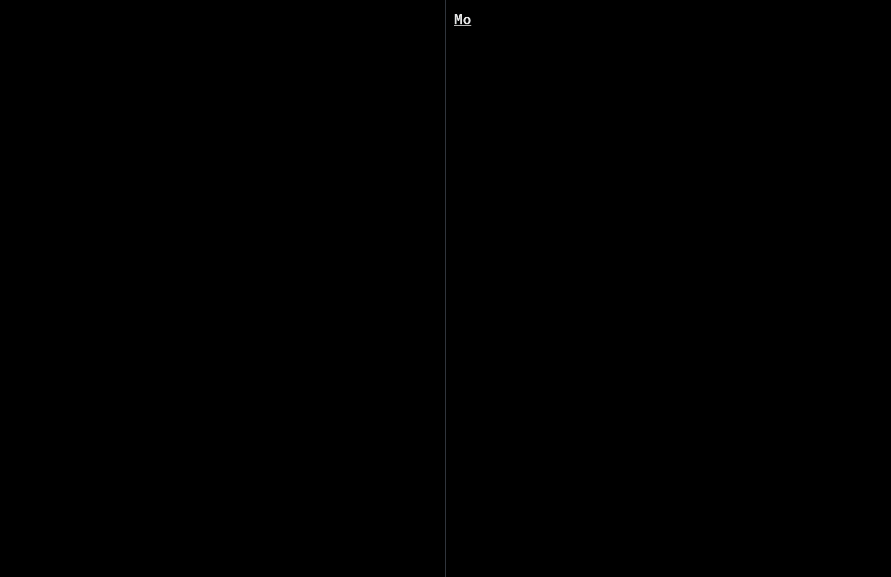
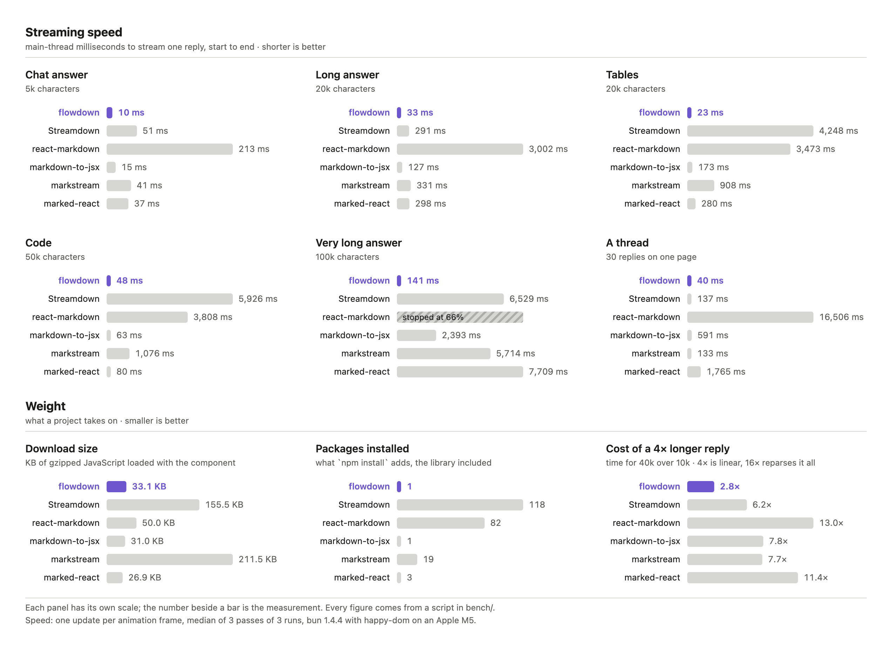

<p align="center">
  <picture>
    <source media="(prefers-color-scheme: dark)" srcset="docs/assets/logo.svg">
    
  </picture>
</p>

<h1 align="center">flowdown</h1>

<p align="center">
  <strong>Ultrafast, lightweight streaming Markdown for React and AI replies</strong><br>
  Its own parser · 0 dependencies · 33 KB gzipped · 17× faster on a long stream
</p>

<p align="center">
  <a href="https://www.npmjs.com/package/@localix-ai/flowdown"></a>
  <a href="crates/flowdown/README.md"></a>
  <a href="https://github.com/localixai/flowdown/actions/workflows/ci.yml"></a>
  <a href="packages/flowdown/LICENSE"></a>
</p>

<p align="center">
  <a href="https://flowdown.dev"><b>flowdown.dev</b></a> ·
  <a href="https://flowdown.dev/docs/getting-started">Get started</a> ·
  <a href="https://flowdown.dev/docs/syntax">Syntax</a> ·
  <a href="https://flowdown.dev/docs/api">API</a> ·
  <a href="https://flowdown.dev/docs/comparison">Comparison</a> ·
  <a href="https://flowdown.dev/docs/rust">Rust</a>
</p>

<p align="center">
  
</p>

<p align="center">
  <sub>One reply, streamed twice: by <code>&lt;Markdown&gt;</code> on a page and by <code>@localix-ai/flowdown/tui</code> in a terminal.</sub>
</p>

flowdown draws a model's reply as it arrives: GitHub Markdown, plus the forms a model can write
and a reader can scan, such as steps, tabs, headline figures, pros and cons, callouts, folded
sections, sources, file trees, titled code, diagrams and math. Nothing flickers, and no raw syntax
shows while the text is still coming in. It works in React, on a page with no framework, on a
server and in a terminal, and a Rust crate reads the same dialect.

```sh
npm install @localix-ai/flowdown
```

```tsx
import { Markdown } from '@localix-ai/flowdown'
import '@localix-ai/flowdown/styles.css'

export function Reply({ text, done }: { text: string; done: boolean }) {
  return <Markdown streaming={!done}>{text}</Markdown>
}
```

`<Markdown>` needs React 18 or 19. A model writes the forms once its system prompt teaches them:
add `answerFormatPrompt()` from `@localix-ai/flowdown/prompt`
([prompting](https://flowdown.dev/docs/prompting)).

## Why

- **Fast.** A 100k-character reply streams in 0.14 s. The next fastest renderer takes 2.4 s, and
  Streamdown takes 6.5 s.
- **Linear.** A reply four times longer costs 2.8 times more, not sixteen, and no update takes
  more than 5 ms.
- **Repairs a reply mid-stream.** Unfinished `**bold`, half-typed links and open code fences never
  show their raw syntax.
- **Complete.** Its parser passes every example of CommonMark and of GitHub's extensions
  ([conformance](https://flowdown.dev/docs/conformance)).
- **Light.** One package with no dependencies, 33 KB gzipped, styled without Tailwind.
- **Safe.** Raw HTML from a reply is sanitized, and links are held to safe protocols.

<p align="center">
  <a href="https://flowdown.dev/docs/comparison"></a>
</p>

Every figure, how it was measured, and the cases where another renderer suits better are in
[the comparison](https://flowdown.dev/docs/comparison).

## Beyond React

One package covers every target, each behind its own import path. Only the first one imports
React.

| Import                         | Draws                                              |
| ------------------------------ | -------------------------------------------------- |
| `@localix-ai/flowdown`         | React elements                                     |
| `@localix-ai/flowdown/static`  | HTML text, for a server or an email                |
| `@localix-ai/flowdown/dom`     | a page with no framework, kept up to date in place |
| `@localix-ai/flowdown/element` | `<flow-down>`, for Vue, Svelte, Solid or Angular   |
| `@localix-ai/flowdown/tui`     | the rows of a terminal                             |

Each target's options are in [other targets](https://flowdown.dev/docs/targets). Further entries
give you the pieces for a renderer of your own: the parser (`/engine`), a growing reply as blocks
(`/document`), a remark plugin (`/remark`), the prompt (`/prompt`), and code, math and diagrams
(`/highlight`, `/math`, `/mermaid`). [The API](https://flowdown.dev/docs/api) lists them all.

## In Rust

A Rust crate with no dependencies reads the same dialect into a tree, for a terminal, a server
or an agent written in Rust. It is held to the same specifications as the npm package, passes the
same cases of the dialect's forms ([spec/](spec/README.md)) and teaches a model with the same
prompt.

```toml
[dependencies]
flowdown = { git = "https://github.com/localixai/flowdown", tag = "rust-v0.1.0" }
```

```rust
let doc = flowdown::parse("> [!STEPS] Cut a release\n1. **Run the checks**\n2. **Tag it**\n");
```

It builds its tree faster than `pulldown-cmark` pulls its events. What it reads, how fast and how
it is made: [crates/flowdown](crates/flowdown/README.md) and
[the Rust crate](https://flowdown.dev/docs/rust) page of the docs.

## Documentation

Everything is at **[flowdown.dev](https://flowdown.dev/docs)**:

- **Start:** [introduction](https://flowdown.dev/docs/introduction) ·
  [getting started](https://flowdown.dev/docs/getting-started) ·
  [comparison](https://flowdown.dev/docs/comparison)
- **Writing:** [syntax](https://flowdown.dev/docs/syntax) ·
  [prompting](https://flowdown.dev/docs/prompting) ·
  [conformance](https://flowdown.dev/docs/conformance)
- **Rendering:** [streaming](https://flowdown.dev/docs/streaming) ·
  [styling](https://flowdown.dev/docs/styling) ·
  [components](https://flowdown.dev/docs/components) ·
  [math](https://flowdown.dev/docs/math) · [diagrams](https://flowdown.dev/docs/diagrams) ·
  [highlighting](https://flowdown.dev/docs/highlighting) ·
  [security](https://flowdown.dev/docs/security)
- **Beyond React:** [other targets](https://flowdown.dev/docs/targets) ·
  [extensions and remark](https://flowdown.dev/docs/remark) ·
  [the Rust crate](https://flowdown.dev/docs/rust)
- **Recipes:** [Vercel AI SDK](https://flowdown.dev/docs/recipes/ai-sdk) ·
  [a documentation site](https://flowdown.dev/docs/recipes/docs-site) ·
  [migrating](https://flowdown.dev/docs/recipes/migrating)
- **Reference:** [API](https://flowdown.dev/docs/api) · releases of the
  [npm package](packages/flowdown/CHANGELOG.md) and of the
  [Rust crate](crates/flowdown/CHANGELOG.md)

## Development

```sh
bun install
bun run test     # the library's tests
bun run check    # the build's exports, types and entry isolation
bun run bench    # the benchmarks, against other renderers

crates/flowdown/scripts/check   # the Rust crate: fmt, clippy, tests, docs, the wasm build
```

| Folder | What it holds |
| --- | --- |
| [`packages/flowdown`](packages/flowdown) | The npm package. |
| [`crates/flowdown`](crates/flowdown/README.md) | The Rust crate, with its own benchmarks. |
| [`spec/`](spec/README.md) | What both parsers are held to: CommonMark's and GitHub's specifications, and the dialect's forms. |
| [`docs/`](docs) | The documentation, each file a page of the site. |
| [`site/`](site/README.md) | flowdown.dev. |
| [`bench/`](bench/README.md) | The benchmarks every published figure comes from. |

How to work on it: [CONTRIBUTING.md](CONTRIBUTING.md).

## License

[MIT](packages/flowdown/LICENSE)
