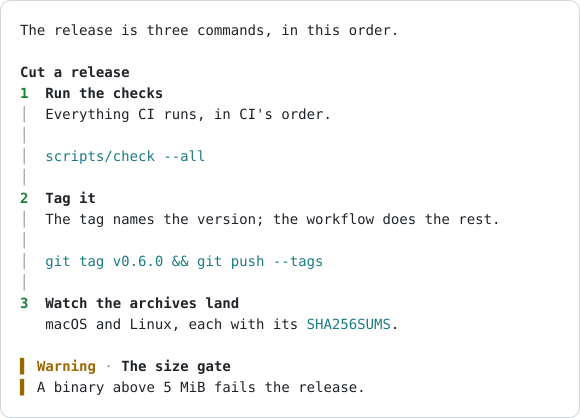
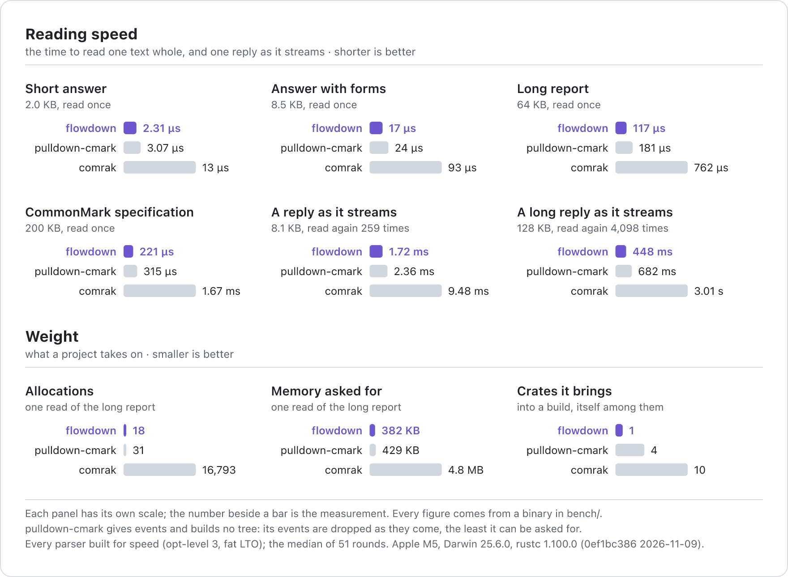
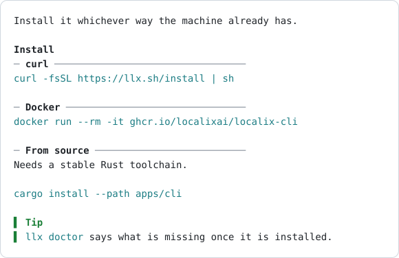
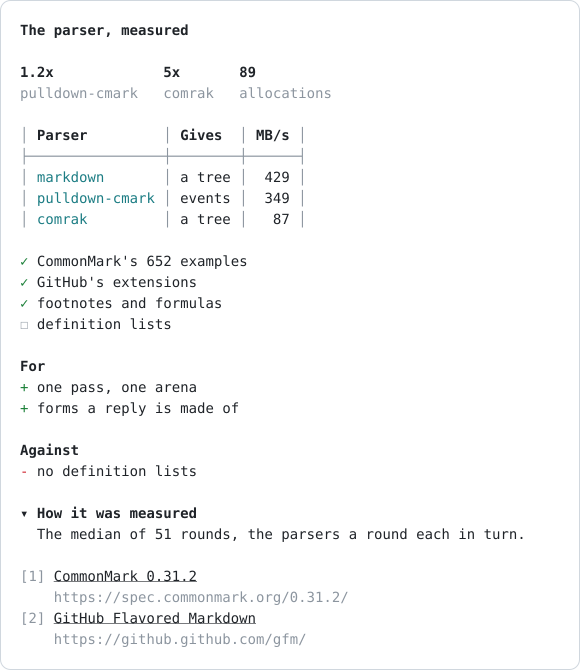
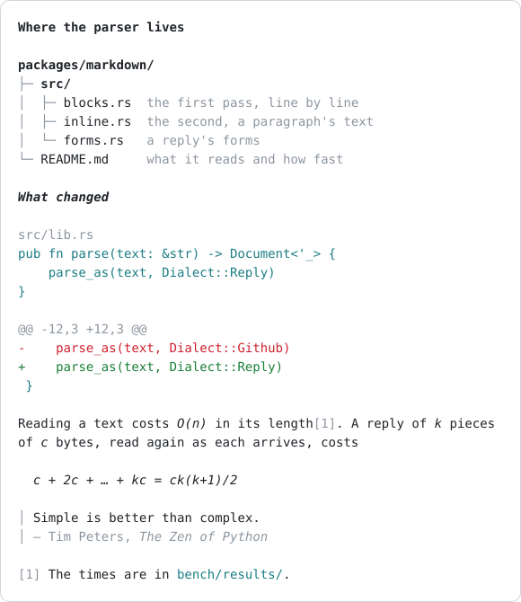

<h1 align="center">flowdown</h1>

<p align="center">
  <strong>The Markdown a model writes, read into a tree, in Rust</strong><br>
  All of CommonMark · GitHub's extensions · the forms of a reply · 0 dependencies · 429 MB/s
</p>

<p align="center">
  <a href="#taking-it">Take it</a> ·
  <a href="#use">Use</a> ·
  <a href="#the-forms-of-a-reply">Forms</a> ·
  <a href="#telling-the-model">Prompt</a> ·
  <a href="#what-it-reads">What it reads</a> ·
  <a href="#measured">Measured</a> ·
  <a href="#how-it-is-made">How it is made</a>
</p>

<p align="center">
  <picture>
    <source media="(prefers-color-scheme: dark)" srcset="assets/steps-dark.svg">
    
  </picture>
</p>

A Rust parser for what a language model answers with: all of CommonMark, GitHub's tables,
strikethrough, task lists and bare links, and the forms a reply is made of (a callout, steps,
tabs, figures, the case for and against, a folded section, sources). Any text is a document:
nothing fails, and a reply cut mid-stream reads as far as it goes.

It is the Rust half of [flowdown](../../README.md): the npm package `@localix-ai/flowdown` reads the
same dialect and draws it in React, on a page or in a terminal. The two parsers pass the same
cases ([`spec/`](../../spec/README.md)) and teach a model with the same prompt. The pictures here
are [Localix CLI](https://github.com/localixai/localix-cli)'s terminal renderer drawing what this
crate read; how a tree is drawn is the program's, not the crate's.

## Why

- **Fast.** It builds its tree 1.2 times as fast as `pulldown-cmark` pulls its events and 4.7
  times as fast as `comrak` builds its own: 429 MB/s against 357 and 90. A 64 KB report is read
  in 117 µs.
- **Made for a stream.** An interface reads the whole reply again as each piece of it arrives.
  A 128 KB reply read again 4,098 times takes 0.45 s here, 0.68 s with `pulldown-cmark` and
  3.0 s with `comrak`; its slowest single read is 0.25 ms.
- **Light.** No dependency at all: one crate in a build, where `pulldown-cmark` brings 4 and
  `comrak` 10. That 64 KB report costs 18 allocations, against 31 and 16,793.
- **Linear.** Time and memory grow with the text, whatever it is: each of 19 texts built to be
  slow costs 3.5 to 5.5 times as much at four times the size, never sixteen.
- **The forms of a reply.** Steps, tabs, figures and sources are in the tree as what they are,
  not as a quote and a list, and the text that teaches a model to write them comes with the
  parser.
- **Whole.** Every one of CommonMark's 652 examples reads as the specification says, and every
  case of the dialect's forms as the npm package reads it.

<p align="center">
  <picture>
    <source media="(prefers-color-scheme: dark)" srcset="assets/compare-dark.png">
    
  </picture>
</p>

How these are measured, and where the lead is small, is under [Measured](#measured).

## Taking it

From this repository by its tag; the crate is not on crates.io yet. It builds on Rust 1.89 and
later, and for `wasm32-unknown-unknown`.

```toml
[dependencies]
flowdown = { git = "https://github.com/localixai/flowdown", tag = "rust-v0.1.0" }
```

Its versions are its own, apart from the npm package's: [CHANGELOG.md](CHANGELOG.md).

## Use

```rust
use flowdown::{Callout, Kind, parse};

let doc = parse("> [!WARNING] Downtime\n> The migration locks the table.\n\n1. **Stop** the writers\n");
let mut blocks = doc.blocks();

let callout = blocks.next().unwrap();
assert_eq!(callout.kind(), Kind::Callout(Callout::Warning));
assert_eq!(callout.title(), "Downtime");

let list = blocks.next().unwrap();
assert_eq!(list.kind(), Kind::List { ordered: true, tight: true });
let strong = list.first().and_then(|item| item.first()).and_then(|text| text.first()).unwrap();
assert_eq!(strong.kind(), Kind::Strong);
assert_eq!(strong.first().unwrap().text(), "Stop");
```

- `parse(text)`: the text as a reply. `parse_as(text, dialect)`: `Dialect::CommonMark` (the
  specification and nothing else), `Dialect::Github` (with its tables, strikethrough, task lists
  and bare links), `Dialect::Reply` (with the forms too).
- `Document`: `root()`, `blocks()`, and `into_owned()` for a caller that cannot keep the source.
- `Node`, a place in the tree, `Copy`: its `kind()`, and what that kind has: `text()` (a text's,
  a code span's or block's, an HTML block's), `info()` (what follows a fence), `dest()` and
  `title()` (a link's or an image's; `title()` is a form's title too, and a tab's label),
  `start()` (an ordered list's first number), `aligns()` (a table's columns), then
  `children()`, `first()` and `next()`.
- `Kind` is matched exhaustively: a renderer that forgets a node does not compile.

## The forms of a reply

A form is a quote whose first line is a marker. It is asked for by that marker and never
guessed; one with nothing it can take stays the quote it was written as, and in any other
Markdown reader the whole thing is a quote and a list, still readable.

| Marker | What it takes | What it is |
| --- | --- | --- |
| `> [!NOTE]`, `[!TIP]`, `[!IMPORTANT]`, `[!WARNING]`, `[!CAUTION]` | the quote | a callout (GitHub's alerts); the rest of the marker's line its title |
| `> [!STEPS] title` | the list after it | stages in order |
| `> [!TABS] title` | the headings after it, up to a rule or a shallower heading | variants side by side, each heading a tab's label |
| `> [!STATS]` | the list after it | headline figures |
| `> [!PROS]`, `> [!CONS]` | the list after it | the case for and against |
| `> [!DETAILS] title` | the quote | secondary material under its title |
| `> [!SOURCES]` | the list after it | the pages a reply draws on |

What a form takes may be quoted with it or follow it unquoted, a blank line between or none, and
forms nest (a tab may hold steps):

````markdown
> [!STEPS] Cut a release
> 1. **Run the checks**
>    Everything CI runs, in CI's order.
> 2. **Tag it**

> [!TABS] Install
> #### curl
> ```sh
> curl -fsSL https://llx.sh/install | sh
> ```
> #### Docker
> ```sh
> docker run --rm -it ghcr.io/localixai/localix-cli
> ```
````

<picture>
  <source media="(prefers-color-scheme: dark)" srcset="assets/tabs-dark.svg">
  
</picture>

A terminal folds nothing and switches nothing: tabs are drawn one under another, each under a
rule that holds its label, and a folded section under its title. The tree says only what a form
is; how it is shown is the renderer's. Localix CLI's gives a table's columns room by what they hold and
rules its rows apart when they hold long text, stands a task's mark where its bullet would,
puts figures side by side, each number over what it counts (a list where no row holds them),
gives a step's name and a source's address a row of their own, and keeps a code span on one row
where a row holds it.

<picture>
  <source media="(prefers-color-scheme: dark)" srcset="assets/report-dark.svg">
  
</picture>

What is not a form is drawn as what it is too: a fence that names its file (` ```rust src/lib.rs `,
or `title="…"`) under the name, a `diff` by what its lines add and take away, a ` ```tree ` fence
as a file tree, what is said of the names in one column; a formula as the Unicode a terminal has
(`\frac{ck(k+1)}{2}` is `ck(k+1)/2`, `x^2` is `x²`), one that stands apart set in on rows of its
own; a footnote as its number where it is named and its text at the end; a quote's last line
that opens with a dash as its source.

<picture>
  <source media="(prefers-color-scheme: dark)" srcset="assets/files-dark.svg">
  
</picture>

### Telling the model

A model writes the forms it was told of and no others, so the text that teaches them comes with
the parser: `flowdown::prompt()` is a section for a system prompt or a context (a heading, a rule
a line, an example under those a model cannot guess). It is the npm package's own
(`answerFormatPrompt({ math: true })`), written here by its `bun run prompt`, so a model is taught
one text whichever parser reads its reply; the tests read every example in it into the form it
shows.

## What it reads

- **CommonMark 0.31.2**: every one of the specification's 652 examples reads as the
  specification says (`src/lib_tests.rs`, from the repository's `spec/commonmark/spec.txt`, the
  file the npm package's tests read), and the same with GitHub's extensions on, but for the two
  that are about a bare address.
- **GitHub's extensions**: tables, strikethrough, task lists, bare links (`https://…`, `www.…`),
  by the examples of GitHub's specification (`spec/github/gfm-spec.txt`), but for the three bare
  e-mail addresses, left as text.
- **The forms of a reply**: every case of `spec/forms/spec.txt`, the cases the npm package's
  parser is held to as well (`src/forms_tests.rs`).
- **Footnotes**, with GitHub's extensions: `[^label]` where a `[^label]: text` defines it, the
  definition's lines after its first indented by four columns. Each is numbered as it is first
  referred to (`Kind::FootnoteRef`, its number `start`), and the ones referred to are the
  document's last block (`Kind::Footnotes`, each a `Kind::Footnote` holding the definition's
  blocks); a definition leaves the flow where it was written, one never referred to the tree, and
  a `[^label]` that names none stays text.
- **Formulas**, in a reply: `$x$` and `$$x$$` in a line (`Kind::Math`), a `$$` fence or a
  `math` one (`Kind::MathBlock`), `text` the LaTeX. A single `$` follows pandoc's rule, and a
  dollar sign by its look is none: `$5`, `$1.5M`, `$HOME/bin` and `$PATH` are text.
- **Not read**: definition lists, GitHub's filter of raw HTML tags. Raw HTML is kept as text for
  the renderer to show or drop; nothing here writes HTML.
- **Any text at all**: every example cut at every byte, and pieces put together at random, are
  read (`src/tree_tests.rs`); a code span or a fence left open reads as code to the end, as a
  reply does while it streams.

## Measured

Against the two Rust parsers a project would otherwise take: `pulldown-cmark` 0.13.5 (events,
no tree) and `comrak` 0.44 (a tree). Seven texts, 0.9 MB: replies of 1 KB to 512 KB generated
from fixed seeds, the same in GitHub's Markdown only, pulldown-cmark's own benchmark text, and
the CommonMark specification. Each parser a round in turn, the median of 51.

| Parser | Gives | Built for speed | Built for size | Allocations | Allocated |
| --- | --- | ---: | ---: | ---: | ---: |
| `flowdown` | a tree | 429 MB/s | 194 MB/s | 89 | 4.4 MB |
| `flowdown`, every node then visited | a tree, walked | 407 MB/s | 167 MB/s | 89 | 4.4 MB |
| `pulldown-cmark` | events, dropped | 357 MB/s | 182 MB/s | 262 | 5.2 MB |
| `pulldown-cmark`, events kept | events in a `Vec` | 314 MB/s | 171 MB/s | 339 | 13 MB |
| `comrak` | a tree | 90 MB/s | 55 MB/s | 217,548 | 54 MB |

Apple M5, rustc 1.100.0. Built for speed is every parser at `opt-level = 3`, as this workspace
builds the crate; built for size is every parser at `opt-level = "z"`, as a program that ships
small binaries builds them.

How much faster it is, over everything measured:

| | than `pulldown-cmark` | than `pulldown-cmark`, events kept | than `comrak` |
| --- | ---: | ---: | ---: |
| The whole corpus, built for speed | 1.2× | 1.4× | 4.7× |
| The whole corpus, built for size | 1.1× | 1.1× | 3.5× |
| One text, the least and the most of 7 | 1.1× to 1.8× | 1.3× to 2.0× | 4.0× to 10× |
| One construct repeated, of 19 | 0.97× to 4.2× | 1.2× to 4.5× | 4.1× to 20× |
| A reply read again as it streams, of 4 | 1.4× to 2.1× | 1.5× to 2.6× | 5.5× to 8.1× |
| Allocations over the corpus, fewer by | 2.9× | 3.8× | 2,444× |
| Memory asked for over the corpus, less by | 1.2× | 2.9× | 12× |

Every figure here is held to [`bench/budgets.json`](bench/budgets.json) by the bench's `check`,
which CI runs on the committed results: never slower than `pulldown-cmark` on a text or a stream,
at least 1.1 times as fast over the corpus, a handful of allocations a read, and texts built to be
slow that grow at most six times at four times their size.

- [`bench/results/parse.md`](bench/results/parse.md): each text, the time of one read and its
  allocations (exact: the texts are fixed), built for speed;
  [`parse-size.md`](bench/results/parse-size.md), the same with every parser built for size.
- [`bench/results/constructs.md`](bench/results/constructs.md): one construct repeated,
  nanoseconds a byte.
- [`bench/results/stream.md`](bench/results/stream.md): a reply read again as each piece of it
  arrives, as an interface does while a model writes.
- [`bench/results/worst.md`](bench/results/worst.md): texts built to be slow, at one size and
  at four times it: the time grows as the text does.

It is the faster of the three on every text, every stream and every text built to be slow, and
on every construct but one. What the numbers do not say:

- On bare links it is a little behind (0.68 against 0.66 ns a byte), and `pulldown-cmark` does
  not link them.
- Built for size, the tree built and then walked is behind `pulldown-cmark`'s events, dropped and
  kept (167 against 182 and 171 MB/s); the tree alone is ahead (194).
- On the 512 KB reply the lead is its smallest, 1.1 times.
- `pulldown-cmark` reads definition lists, and `comrak` many more extensions and writes HTML;
  this reads none of those ([What it reads](#what-it-reads)).
- The machine was not idle when these were taken (a load average near 3), which is why the
  parsers are timed a round each in turn: the ratios held from run to run, the absolute times
  moved by a tenth.

To run them again: `sh bench/run.sh` (it fetches pulldown-cmark's sources once for its benchmark
text, builds, writes `bench/results/` and `assets/`: the chart as an SVG and, drawn from it by
`resvg`, the PNG shown above, then holds the results to the budgets). The times are the
machine's; the allocation counts are the same on every run.

## How it is made

- **Two passes.** `blocks.rs` reads the text line by line into blocks (which open blocks a line
  goes on, which it opens), keeping each paragraph's text as places in the source; `inline.rs`
  then reads each paragraph: one scan for the characters that can mean something, delimiter runs
  resolved on a stack, brackets on another.
- **One arena.** A node is one entry of a `Vec`, its relatives indexes into it; its text is two offsets
  into the source, or into the one `String` the parser writes what it had to change into (an
  entity decoded, a line taken out of a quote). A document is a handful of allocations that grow, not
  one a node.
- **Bounded.** Every loop that could run again over the same text has a bound that makes the
  whole linear: a backtick run's closer is looked for once a length, a link's brackets nest 32
  deep, a table's missing cells are filled only while the text is longer than what filling adds.
- **Tables, not code.** Entities (`data/entities.txt`, 2,125 names) and Unicode's punctuation
  (`data/punct.bin`, 351 ranges, Unicode 17) are data searched by halves, written by the npm
  package's `bun run crate-tables` from what that parser reads, so the two decode and delimit
  alike.
