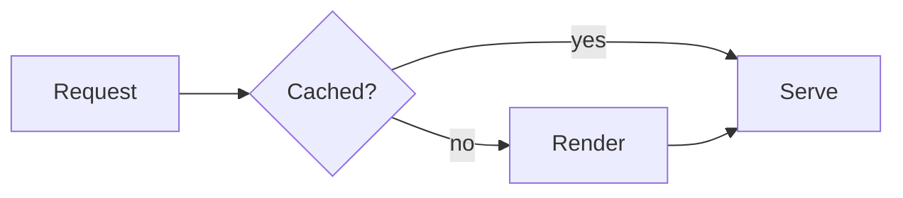

Basics
---
# Heading one
## 1.2 Heading two with a number
### Heading three
#### Heading four

A paragraph with **bold**, *italic*, ~~struck~~, `inline code`, a [link](https://example.com), <kbd>⌘</kbd> + <kbd>K</kbd> and a footnote[^1].

- A list item
  - nested item with `code`
    - third level
- Second item

1. Ordered
2. List
   1. nested ordered

- [x] Done task
- [ ] Open task
  - [ ] nested task

| Name | Type | Default | Notes |
| ---- | :--: | ------: | ----- |
| `streaming` | boolean | `false` | The reply is still arriving |
| `html` | stage | — | Raw HTML, parsed and sanitized |

---

```tree
my-app/
├── src/
│   ├── main.ts      # entry point
│   └── routes/
│       └── index.ts
└── package.json
```

```ts title="server.ts"
export function serve(port = 3000) {
  // a comment
  return Bun.serve({ port, fetch: () => new Response('ok') })
}
```

```diff
- const a = 1
+ const a = 2
```

Inline math $e^{i\pi} + 1 = 0$ and a display formula:

$$
\int_0^1 x^2\,dx = \frac{1}{3}
$$



[^1]: The footnote text.
