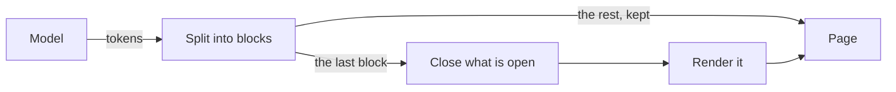

How does a streamed reply reach the page?
---

Only the last block is parsed again, so an update costs the same at any length: with $n$ blocks and
$k$ new characters, the work is

$$
O(k) \quad \text{instead of} \quad O\Big(\sum_{i=1}^{n} |b_i|\Big)
$$
