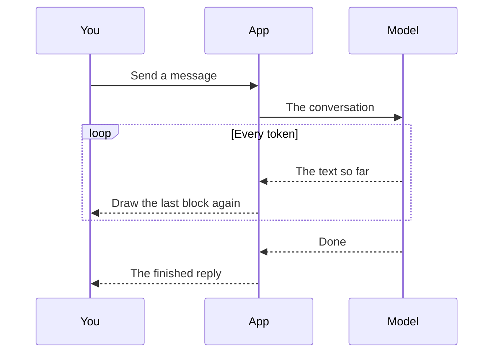

What happens between my message and the reply?
---

The page draws while the model writes. Hover the diagram for its toolbar: **Enlarge** opens a viewer
that zooms and pans, and the other buttons show, copy and download the source.
