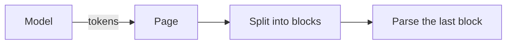

# Diagrams

A ` ```mermaid ` fence is a diagram. Without a Mermaid loader it is shown as its source; pass one to
draw it:

```tsx
import { Markdown } from 'llx-markdown'

const loadMermaid = () => import('mermaid')

export function Reply({ text }: { text: string }) {
  return <Markdown mermaid={loadMermaid}>{text}</Markdown>
}
```

Install `mermaid`. It is not a dependency of llx-markdown: the page imports it through the loader,
so a page without diagrams never bundles it, and you choose its version. The loader is called the
first time a document holds a diagram.

````markdown

````


## What is drawn when

| Situation                         | Shown                                                                   |
| --------------------------------- | ----------------------------------------------------------------------- |
| No `mermaid` loader               | The source, as code.                                                    |
| The fence is still being written  | The source, as code. A diagram is drawn only once its fence is closed.  |
| Mermaid is loading or laying out  | The source, with "Drawing diagram…" under it.                           |
| Drawn                             | The diagram, `figure.llx-diagram` labelled "Diagram" for screen readers, with its [toolbar](#toolbar-and-viewer). |
| The source does not parse         | The source, with "Diagram could not be drawn:" and Mermaid's first error line. |

Waiting for the closed fence keeps a streaming reply calm: a half-written diagram would otherwise
fail to parse on every token and flash an error, or redraw its layout dozens of times.

Diagrams are drawn in the browser only. On a server, and in the first render of a hydrating page,
the source is shown; the diagram replaces it after hydration.

## Toolbar and viewer

A drawn diagram has a small toolbar in its top right corner. It shows when the pointer is over the
diagram or the focus is in it, and always on a touch screen, where its buttons are 44 px targets.

| Button                       | Does                                                                     |
| ---------------------------- | ------------------------------------------------------------------------ |
| Enlarge diagram              | Opens the viewer.                                                        |
| Show source / Show diagram   | Swaps the picture for its Mermaid source, and back.                      |
| Copy source                  | Copies the source; the button reads "Copied" for a moment. Uses the Clipboard API, and the copy command where the page has no access to it. |
| Download SVG                 | Saves the picture as `diagram.svg`, sized by its own `viewBox`.          |

A fence still being written, one Mermaid is still drawing, and one that failed show their source
and no toolbar: there is no picture to enlarge or save.

The viewer is a modal `<dialog>` over most of the window (all of it on a phone), with the diagram
fitted to it:

| To                     | Pointer                         | Keys            |
| ---------------------- | ------------------------------- | --------------- |
| Pan                    | Drag                            | Arrow keys      |
| Zoom                   | Wheel, trackpad pinch, two fingers, or **−** and **+** | `-` and `+` |
| Fit to the window      | The fit button                  | `0`             |
| See it at its own size | The percentage (100%)           |                 |
| Close                  | The close button, or a click outside | Escape     |

On close the focus returns to the Enlarge button. The zoom buttons and keys glide unless the reader
has asked for reduced motion; a drag or a pinch follows the hand. The viewer's code is its own
chunk, loaded the first time the pointer or the focus reaches an Enlarge button, so a page whose
diagrams are never enlarged does not download it.

The words are [labels](components.md#labels) (`enlarge`, `showSource`, `zoomIn`, `close`, …), and
the classes are in [Styling](styling.md#restyling-an-element).

## Colours and themes

A diagram is drawn in the colours of the Markdown around it, not in Mermaid's default palette.
llx-markdown reads the resolved tokens and passes them to Mermaid's `base` theme:

| Token                                   | Used for                          |
| --------------------------------------- | --------------------------------- |
| `--llx-bg`, `--llx-fg`                  | The background and text.          |
| `--llx-fg-soft`, `--llx-fg-faint`       | Secondary text and lines.         |
| `--llx-border`, `--llx-border-strong`   | Node borders and edges.           |
| `--llx-chart-1` … `--llx-chart-8`       | Series and categories: pie slices, chart lines, sections. |

When the colours change, the diagram is drawn again: the system's light or dark scheme, or the
`class`, `data-theme` or `style` attribute of `<html>` (where theme switchers put it). A look that
was drawn before comes from the cache, so switching back is instant.

## Kinds

Any kind your Mermaid version knows is drawn. The prompt teaches the model the ones that are stable
and useful in a reply: `flowchart`, `sequenceDiagram`, `stateDiagram-v2`, `erDiagram`, `gantt`,
`pie`, `xychart-beta`, `classDiagram`, `mindmap`, `timeline`, `quadrantChart`, `sankey-beta`,
`radar-beta`, `treemap-beta` and `gitGraph`. Turn diagrams on in the prompt and the renderer
together:

```ts
import { answerFormatPrompt } from 'llx-markdown/prompt'

const system = answerFormatPrompt({ diagrams: true })
```

## Safety and cost

- Mermaid runs with `securityLevel: 'strict'`: labels are sanitized and click handlers are off, so a
  diagram in a reply cannot run script or open links on its own.
- Each source is parsed before it is rendered, so an invalid one costs a parse, not a layout.
- All diagrams on the page are drawn through one queue, one at a time, because Mermaid's renderer is
  global. A diagram that unmounts before its turn is dropped from the queue.
- Drawn diagrams are cached by source and colours. A thread that re-renders, or a reply that is
  remounted, does not lay them out again.

## Your own diagram

To put your own frame around a diagram, draw the fence with `components.diagram`. It replaces the
whole of the built-in one: the toolbar and the viewer too, so a page that wants other buttons, or
none, draws its own. Keep the page's renderer, so your diagrams and the built-in ones share one
queue and one cache:

```tsx
import { useEffect, useRef, useState } from 'react'
import type { MarkdownComponents } from 'llx-markdown'
import { mermaidRendererFor, resolveMermaidLook } from 'llx-markdown/mermaid'

const renderer = mermaidRendererFor(() => import('mermaid'))

function MyDiagram({ source }: { source: string }) {
  const frame = useRef<HTMLDivElement>(null)
  const [svg, setSvg] = useState<string | null>(null)
  useEffect(() => {
    const controller = new AbortController()
    const look = resolveMermaidLook(frame.current!)
    renderer.render(source, look, controller.signal).then(setSvg, () => setSvg(null))
    return () => controller.abort()
  }, [source])
  // The SVG comes from Mermaid in strict mode, which removes scripts and event handlers.
  return <div ref={frame} dangerouslySetInnerHTML={svg ? { __html: svg } : undefined} />
}

const components: MarkdownComponents = {
  // The fence still being written has `growing` set: wait for it to close.
  diagram: ({ source, growing }) => (growing ? <p>Drawing…</p> : <MyDiagram source={source} />),
}
```

## Trees are not diagrams

A ` ```tree ` fence draws a directory layout without Mermaid; see [Syntax](syntax.md). It needs no
loader and is drawn on the server too.
