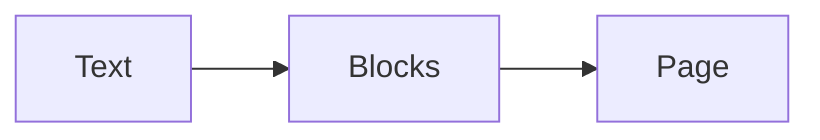

# Syntax

Everything GitHub Markdown has works: headings, emphasis, lists, task lists, tables, footnotes,
strikethrough, autolinks, code. On top of it, the dialect adds forms for what a plain list or
heading cannot show: stages in order, variants side by side, the case for and against.

Two rules hold for all of them:

- **A form is opt-in by its marker.** Nothing is guessed from the shape of the text: a list whose
  items start with bold stays a list until a `> [!STEPS]` marker says otherwise.
- **The source reads anywhere.** A marker is a one-line quote, the content is ordinary Markdown.
  Where the dialect is not rendered, the reader sees a quote line and a list.

## Where a form's content goes

Write the marker as a quote line of its own, then the content **unquoted** after it. This is how
models write these forms, and the renderer reads it by grammar:

- `[!STEPS]`, `[!STATS]`, `[!PROS]`, `[!CONS]` and `[!SOURCES]` take the **one list** right after
  the marker.
- `[!TABS]` takes the sections that start with the heading right after it, up to a shallower
  heading, a `---` line, or the end of the text.

```markdown
> [!STEPS]
1. **Back up**
2. **Switch**

This paragraph is after the steps, not in them.
```

The content may also be quoted along with the marker, the way GitHub's alerts are written. Both
forms render the same:

```markdown
> [!STEPS]
> 1. **Back up**
> 2. **Switch**
```

`[!DETAILS]` is the exception: it folds what is quoted with it and nothing after, since nothing
after a quote says where a folded section would end.

A marker with nothing it can take — no list after `[!STEPS]`, no heading after `[!TABS]` — stays the
quote it was written as.

> [!WARNING] Two lists in a row are one list
> In Markdown, two lists with the same bullet separated only by a blank line are a single list. Put
> a line of text between a form's list and an ordinary list after it, or use another bullet (`*`
> instead of `-`).

## Callouts

GitHub's alerts: `NOTE`, `TIP`, `IMPORTANT`, `WARNING`, `CAUTION`. Text after the marker is the
title.

```markdown
> [!WARNING] Downtime
> The migration locks the table for a few seconds.

> [!TIP]
> Run it at night.
```

> [!WARNING] Downtime
> The migration locks the table for a few seconds.

> [!TIP]
> Run it at night.

- Without a title, the callout prints no label: its kind is announced to screen readers only. A
  printed "Note" in English above a reply in another language read as foreign. The spoken names can
  be translated with [`labels`](components.md#labels).
- Formatting on the marker line (`> [!NOTE] **Do not** …`) is treated as the first line of the body,
  not as a title.
- An unknown kind (`> [!FOO]`) is an ordinary quote with its text intact, as on GitHub.

## Steps

A list of stages read in order becomes a timeline. Each item opens with its **bold title**; an
_italic line_ right after it is the quiet "when"; the rest is its text.

```markdown
> [!STEPS] Recovery
1. **Rest**
   *Day 1*
   Keep warm and drink water.
2. **Walk**
   *Days 2–3*
   Ten minutes, twice a day.
3. **Run**
   *Week 2*
   Easy pace, no hills.
```

> [!STEPS] Recovery
1. **Rest**
   *Day 1*
   Keep warm and drink water.
2. **Walk**
   *Days 2–3*
   Ten minutes, twice a day.
3. **Run**
   *Week 2*
   Easy pace, no hills.

The title, the "when" and the text may share a line (`1. **Rest** *Day 1* Keep warm.`). An item that
does not open with bold keeps its dot on the line and is otherwise left as written. Text after the
marker (`Recovery`) titles the timeline.

## Tabs

Variants of one thing — per operating system, per language, per option — become tabs. Each heading
opens a tab and names it.

````markdown
> [!TABS]
#### macOS

```sh
brew install llx
```

#### Linux

```sh
curl -fsSL https://example.com/install.sh | sh
```

---

Both put `llx` on your `PATH`.
````

> [!TABS]
#### macOS

```sh
brew install llx
```

#### Linux

```sh
curl -fsSL https://example.com/install.sh | sh
```

---

Both put `llx` on your `PATH`.

- The tabs use the level of the first heading after the marker; `####` is the convention, any level
  works. A heading of that level opens the next tab, a deeper one stays inside the tab.
- The tabs end at a shallower heading, a `---` line, or the end of the text.
- A label keeps the heading's text without its formatting: `#### **macOS** \`arm64\`` is labelled
  "macOS arm64".
- Every panel stays in the page, hidden but present, so find-in-page, copy and print reach it.
- The arrow keys, Home and End move between tabs; only the selected tab is a Tab stop.

## Stats

Headline figures: each item is a **bold value** followed by its label.

```markdown
> [!STATS]
- **3×** faster installs
- **−40%** memory
- **0** config files
```

> [!STATS]
- **3×** faster installs
- **−40%** memory
- **0** config files

## Pros and cons

The case for and the case against. Written one after the other, `PROS` then `CONS`, the two sit side
by side; on a narrow screen they stack.

```markdown
> [!PROS]
- typed APIs
- one build for every platform

> [!CONS] Costs
- a build step
```

> [!PROS]
- typed APIs
- one build for every platform

> [!CONS] Costs
- a build step

Either one also works alone. Text after the marker titles that side.

Forms nest where it reads well: a tab can hold its option's pros and cons, as in the
[introduction](introduction.md#what-it-looks-like).

## Folded sections

Long secondary material — a full log, raw output, a derivation — folded under its title, so the
reply stays short and the detail is one click away. The text after the marker is the title; the
content is **quoted** with it.

```markdown
> [!DETAILS] Timings from the last ten runs
> | Step  | Before | After |
> | ----- | -----: | ----: |
> | Build |  212 s |  47 s |
```

> [!DETAILS] Timings from the last ten runs
> | Step  | Before | After |
> | ----- | -----: | ----: |
> | Build |  212 s |  47 s |

- It is a native `<details>`: it opens with a click, Enter or Space, the browser's find-in-page
  opens it on a match, and it prints as the reader left it.
- Anything can go inside: paragraphs, lists, code, tables, a callout.
- Without a title the browser prints its own label ("Details"), in the reader's language.
- A `<details>` written as HTML gets the same look.

## Sources

The pages a reply draws on, as a numbered list of links: each shows its title and its site, and
whatever follows the link is its note.

```markdown
> [!SOURCES]
- [Bundler options](https://bun.sh/docs/bundler) — `typecheck` runs the compiler inside the build
- [Project references](https://www.typescriptlang.org/docs/handbook/project-references.html)
```

> [!SOURCES]
- [Bundler options](https://bun.sh/docs/bundler) — `typecheck` runs the compiler inside the build
- [Project references](https://www.typescriptlang.org/docs/handbook/project-references.html)

- The site is read from the link (`www.` dropped); a relative link shows none.
- A bare URL is named by its site instead of being printed in full.
- Text after the marker titles the list: `> [!SOURCES] Further reading`.
- An item that does not open with a link stays a plain line.

## Quotes with a source

A quote whose last line starts with an em dash (or `--`) and a space shows that line as its source.

```markdown
> Simplicity is prerequisite for reliability. — Edsger W. Dijkstra
```

> Simplicity is prerequisite for reliability. — Edsger W. Dijkstra

A dash inside a sentence, or a quote that is only a source line, is left alone.

## Figures

An image alone in its paragraph becomes a centred figure. Its title — or an italic line directly
beneath it — is the caption.

```markdown


 _A double shot, 25 seconds_
```

An image inside a sentence stays inline.

## Section numbers

A number the author wrote at the start of a heading is set apart from the title. Nothing is ever
numbered automatically.

```markdown
## 1.2 Water temperature

## 3. Results
```

Only a section number counts: `## 2024` and `## 1.5x faster builds` are left as they are.

## File trees

A ` ```tree ` fence of a directory drawing becomes a tree you can fold.

````markdown
```tree
my-app/
├── src/
│   ├── main.ts      # entry point
│   └── routes/
│       └── index.ts
└── package.json
```
````

```tree
my-app/
├── src/
│   ├── main.ts      # entry point
│   └── routes/
│       └── index.ts
└── package.json
```

- Depth is read off the guides: `│` plus three spaces, or four spaces, per level, then `├──` or
  `└──`. ASCII drawings (`|--`, `` `-- ``, `+--`) work too.
- A name ending in `/`, or followed by deeper rows, is a folder.
- A comment after `#`, or after two or more spaces, is set apart from the name.
- A line that does not fit is kept as a plain row, so a slightly crooked drawing still reads.
- Click a folder, or use the arrow keys: Up and Down move, Right opens or enters, Left closes or
  goes to the parent, Home and End jump.

## Diagrams

A ` ```mermaid ` fence is drawn as a diagram, in the colours of the page around it, when the page
passes a Mermaid loader. Without one it is shown as code. See [Diagrams](diagrams.md).

````markdown

````


## Math

`$…$` inline, and `$$…$$` on lines of their own or a ` ```math ` fence for a display formula,
typeset with KaTeX when the page turns math on. See
[Math](math.md).

```markdown
The area is $\pi r^2$.

$$
\sum_{i=1}^{n} i = \frac{n(n+1)}{2}
$$
```

The area is $\pi r^2$.

$$
\sum_{i=1}^{n} i = \frac{n(n+1)}{2}
$$

Prices and variables stay text: `$5 and $10`, `$HOME/bin` and `$PATH` are not formulas.

## Task lists

```markdown
- [x] write the plan
- [ ] tell the team
```

- [x] write the plan
- [ ] tell the team

The boxes show the source's state and are read-only. Each carries `data-task-key`, the offset of its
item in the source, so a page that stores ticks — or rewrites `[ ]` to `[x]` — can make them live.
[Wrapping a built-in component](components.md#wrap-a-built-in-component) is how.

## Code

A fenced block shows its language, a download button and a copy button. Download saves the code
under the fence's file name, or as `code.<ext>` from its language (`code.txt` without one). Code is
highlighted when the page passes a highlighter; see [Highlighting](highlighting.md).

A fence that names its file shows the name in its bar, the way an agent labels the file it writes.
Write `title="…"` (or `filename=`, `file=`) after the language, or the path alone:

````markdown
```ts title="src/routes/users.ts"
export const users = route('/users/:id', handler)
```

```ts src/routes/users.ts
export const users = route('/users/:id', handler)
```
````

```ts title="src/routes/users.ts"
export const users = route('/users/:id', handler)
```

Other words after the language (`{1,3}`, `showLineNumbers`) are not a title and are ignored.

A change reads best as a `diff` fence: with the package's highlighter the added lines are green and
the removed ones red.

````markdown
```diff title="build.config.ts"
-  typecheck: true,
+  typecheck: false,
```
````

```diff title="build.config.ts"
-  typecheck: true,
+  typecheck: false,
```

## Raw HTML

HTML in the text is parsed and sanitized: `<details>`, `<kbd>`, `<sup>`, a README's
`<p align="center">` and sized `` work; scripts, styles, event handlers and unsafe URLs are
removed. See [Security](security.md).
