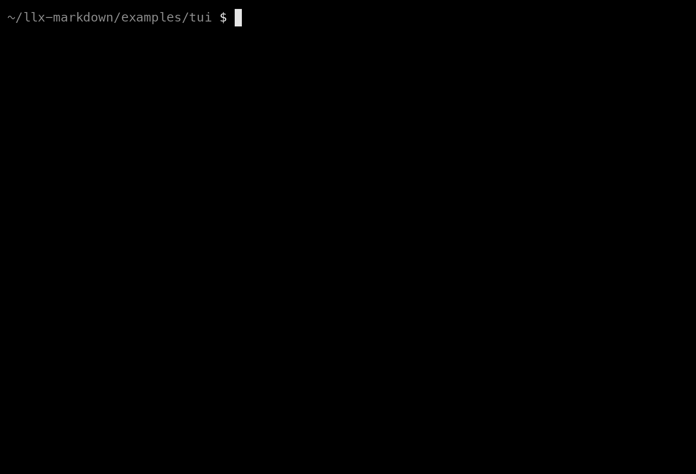

# A reply streamed into a terminal

`reply.md` holds every form `llx-markdown` knows: headings, lists, tasks, callouts, steps, tabs, a
file tree, code, a diff, stats, a table, the case for and against, a diagram, math, a figure, a
folded section, sources and a footnote. `stream.ts` feeds it to
[`llx-markdown/tui`](../../docs/targets.md) a few characters at a time, the way a model sends it,
and redraws the terminal as the text grows. Code is coloured by `llx-markdown/highlight`,
and formulas are written in Unicode.

<p align="center">
  
</p>

```sh
bun install          # once, at the root of the repository
cd examples/tui
bun start
```

| Command                    | What it does                                              |
| :------------------------- | :-------------------------------------------------------- |
| `bun start`                | builds the package, then streams `reply.md`               |
| `bun stream.ts notes.md`   | streams a file of your own                                |
| `DELAY=0 bun stream.ts`    | as fast as the terminal takes it; 12 ms a token otherwise |
| `NO_COLOR=1 bun stream.ts` | the same rows without colours                             |
| `bun stream.ts \| cat`     | not a terminal: the finished reply, once, without colours |
| `bun run record`           | records the run into `docs/assets/readme/tui.gif`         |

## How it draws

`createTerminalView` keeps the reply between renders, so a block that did not change is not drawn
again. Each render returns every row; `draw` compares them with the rows on the screen, moves the
cursor up to the first one that differs, clears from there down and writes the rest. While the last
block grows, that is a few rows per token.

```ts
import { highlight } from 'llx-markdown/highlight'
import { createTerminalView, toAnsi } from 'llx-markdown/tui'

const view = createTerminalView({ width: process.stdout.columns, highlight })
let text = ''
for await (const token of stream) {
  text += token
  draw(view.render(text, { streaming: true }))
}
draw(view.render(text))
```

A terminal cannot rewrite a row that has scrolled out of its window. A footnote or a link defined
far below the place that uses it resolves only when the definition arrives, so the row above stays
as it was first written; `reply.md` keeps its footnote next to its definition for that reason. An
application that owns the whole screen, with its own scrolling, has no such limit.

## The recording

`bun run record` runs `record.sh`: asciinema records the example headless in a window of 100 by 30,
agg draws the frames at 20 a second, and gifsicle fits them to 32 colours, which is every colour a
terminal shows and under half the size. It needs `brew install asciinema agg gifsicle`.
