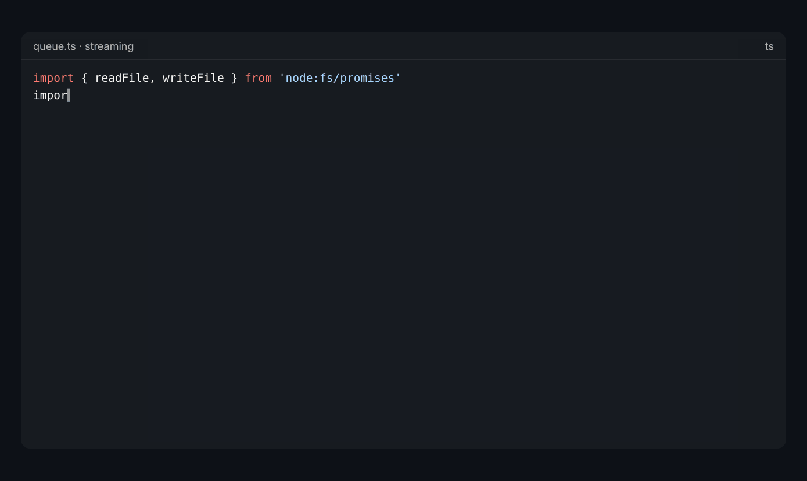
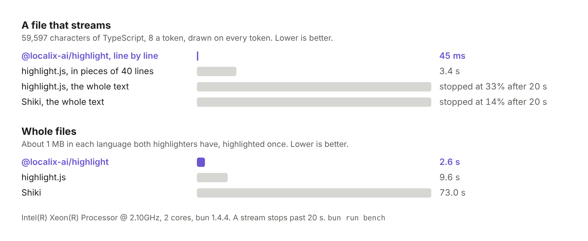
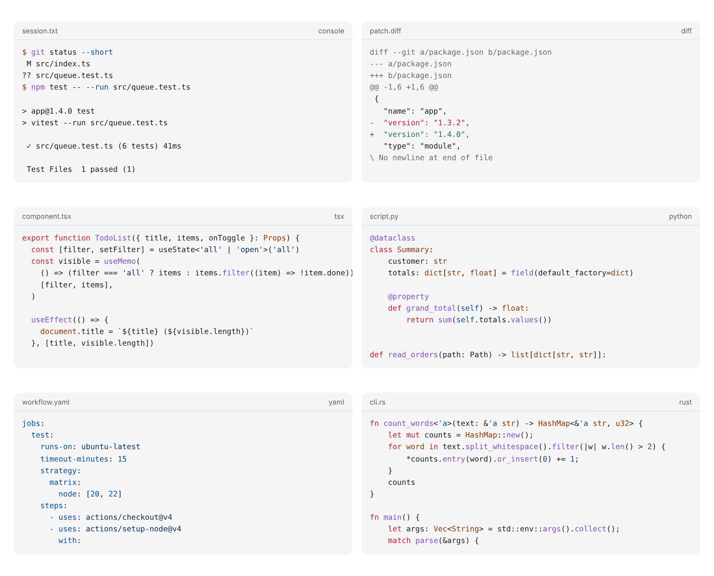

<h1 align="center">@localix-ai/highlight</h1>

<p align="center">
  <strong>Syntax highlighting for code that streams, made for what agents write</strong><br>
  Its own engine · 0 dependencies · 12 KB gzipped · 76× faster than highlight.js on a stream
</p>

<p align="center">
  <a href="https://github.com/localixai/flowdown/actions/workflows/ci.yml"></a>
  <a href="LICENSE"></a>
</p>

<p align="center">
  
</p>

<p align="center">
  <sub>An agent's file as it arrives, coloured a line at a time by <code>createStream</code>.</sub>
</p>

An agent writes a file, a patch or a shell session a token at a time. A highlighter that colours
the whole text colours it again on every token, and a file costs the square of its length. This
one reads each line from the state the line above ended in (inside a comment, a string, a
template, a heredoc), so a complete line is coloured once, the line still being written costs only
itself, and what streams is coloured exactly as the finished text will be.

```sh
npm install @localix-ai/highlight
```

```ts
import { createStream, highlight } from '@localix-ai/highlight'

highlight('const x = 1', 'ts')
// '<span class="hljs-keyword">const</span> x = <span class="hljs-number">1</span>'

// Code that arrives in pieces: each piece gives the lines it completed and the open one.
const stream = createStream('python')!
for await (const piece of pieces) {
  const { done, current } = stream.write(piece)
  for (const line of done) appendLine(line) // each complete line, once
  setOpenLine(current) // the line still being written, again on each piece
}
```

The HTML uses highlight.js's class names (`hljs-keyword`, `hljs-string`, …), so any highlight.js
theme colours it. The code in it is escaped.

## Why

- **Linear.** A file that streams costs its length: 59,597 characters of TypeScript, 8 a token,
  in 45 ms. highlight.js takes 3.4 s even in pieces of 40 lines, and on the whole text it gets a
  third of the way in 20 s.
- **Exact while it streams.** A comment opened forty lines up is still a comment on the line being
  written, and a stream in any pieces gives the HTML of the finished text, byte for byte.
- **Close to an editor.** 84.4% of every character is coloured as Shiki (VS Code's grammars)
  colours it, where highlight.js is at 79.9%; 91.5% on TypeScript, 89.1% on shell.
- **For agents.** Shell sessions (`console`) with their commands and output, diffs, `.env` files,
  Dockerfiles whose `RUN` lines are shell, Markdown whose fences are read as their language.
- **Fast on whole files too.** 3.7× faster than highlight.js and 28× faster than Shiki.
- **Light and safe.** No dependencies, 12 KB gzipped with every language. A language it does not
  know is `null`, never a guess.

<p align="center">
  
</p>

Every figure is from `bun run bench` ([bench/results/latest.md](bench/results/latest.md)) and
`bun run quality` ([bench/results/quality.md](bench/results/quality.md)).

## Languages

<p align="center">
  <picture>
    <source media="(prefers-color-scheme: dark)" srcset="docs/assets/languages-dark.png">
    
  </picture>
</p>

<p align="center">
  <sub>In the colours of flowdown's stylesheet, which colours highlight.js's classes.</sub>
</p>

| Language | Fence names |
| --- | --- |
| Bash | `bash`, `sh`, `shell`, `zsh`, `shellscript`, `fish` |
| Shell session | `console`, `shell-session`, `terminal` |
| C, C++ | `c`, `h`, `cpp`, `c++`, `cc`, `hpp` |
| C# | `csharp`, `cs`, `c#` |
| CSS, SCSS, Less | `css`, `scss`, `sass`, `less` |
| Diff | `diff`, `patch` |
| Dockerfile | `dockerfile`, `docker`, `containerfile` |
| Go | `go`, `golang` |
| HTML, XML | `html`, `xml`, `svg`, `vue`, `svelte` |
| INI, `.env` | `ini`, `cfg`, `conf`, `properties`, `env` |
| Java | `java` |
| JavaScript, JSX | `javascript`, `js`, `jsx`, `mjs`, `cjs` |
| JSON | `json`, `jsonc`, `jsonl` |
| Kotlin | `kotlin`, `kt` |
| Markdown | `markdown`, `md`, `mdx` |
| PHP | `php` |
| Python | `python`, `py` |
| Ruby | `ruby`, `rb` |
| Rust | `rust`, `rs` |
| SQL | `sql`, `postgres`, `mysql`, `sqlite` |
| Swift | `swift` |
| TOML | `toml` |
| TypeScript, TSX | `typescript`, `ts`, `tsx` |
| YAML | `yaml`, `yml` |

Only the language a name gives is read: a name it does not know gives `null` (or escaped text,
from `highlightCode`). Guessing mislabels as often as it helps.

## API

| Export | What it is |
| --- | --- |
| `highlight(code, language)` | HTML, or `null` for a language it does not know. Carries `lines`, so a renderer can colour a growing block line by line. |
| `createStream(language)` | `write(piece)` gives `{ done, current }`: the HTML of the lines the piece completed, and of the line still open. |
| `lines(language)` | `line(text, state)` colours one line from the state the line above ended in and gives `{ html, end }`; `start` is a file's first state. |
| `highlightCode(code, language?)` | As `highlight`, with escaped plain text for a language it does not know. |
| `languageOf(name)` | The language a name gives (`ts` is `typescript`), or `null`. |
| `languages`, `names` | Every language, and every name a fence may give. |
| `Tokenizer`, `Grammar`, `words` | The engine, for a grammar of your own. |

## In flowdown

[flowdown](https://github.com/localixai/flowdown) builds it in: `@localix-ai/flowdown/highlight`
is this highlighter, and a fence still being written is coloured a line at a time on a page, in
the other targets and in a terminal.

```tsx
import { Markdown } from '@localix-ai/flowdown'
import { highlight } from '@localix-ai/flowdown/highlight'

<Markdown streaming highlight={highlight}>{reply}</Markdown>
```

## Development

```sh
bun test                # text kept and escaped in every language, a stream equals the whole, every grammar
bun run typecheck
bun run size            # minified and gzipped, against its budget
bun run references      # clones highlight.js and the TextMate grammars into .refs/
bun run quality         # colours against Shiki and highlight.js, against floors per language
bun run bench           # speed against highlight.js and Shiki, against bench/budgets.json
bun scripts/readme.ts   # this README's pictures
bun run shots           # every test/agent file beside Shiki's colours, light and dark, to look at
```

[test/agent/](test/agent) is the code an agent writes, a file a language: what the tests, the
quality check and the benchmark read. Nothing of highlight.js or the TextMate grammars is copied
here; their code is read from `.refs/` to compare against.

## Licence

MIT
