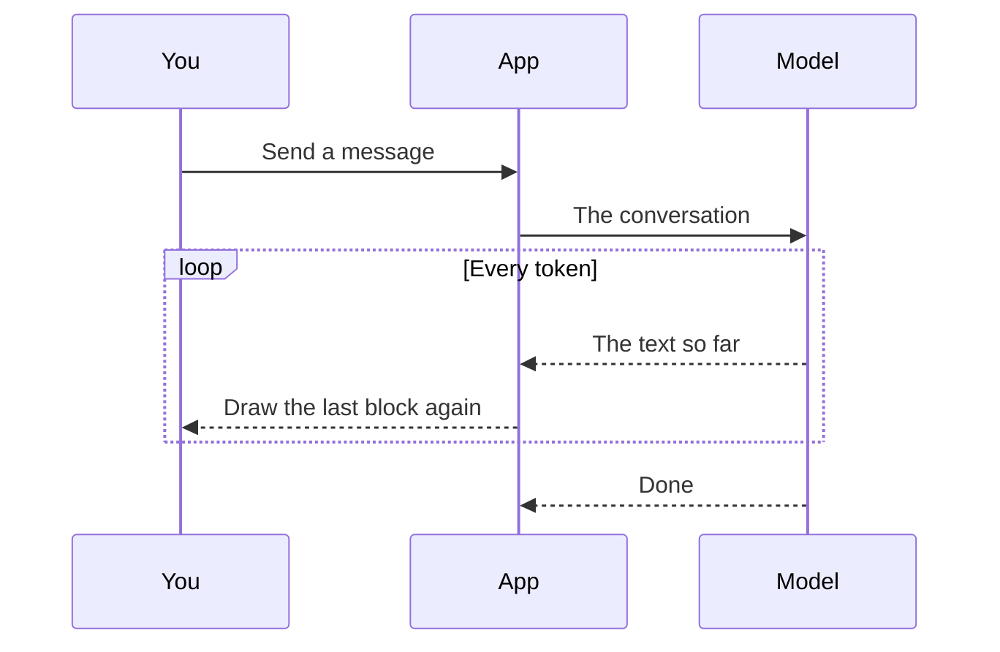

## Between your message and the reply

The page draws while the model writes:

Hover the diagram for its toolbar: **Enlarge** opens a viewer that zooms and pans.

With $n$ characters arriving at $r$ a second, the reply takes

$$
t = \frac{n}{r}
$$

and each update costs the last block, not the whole text.
